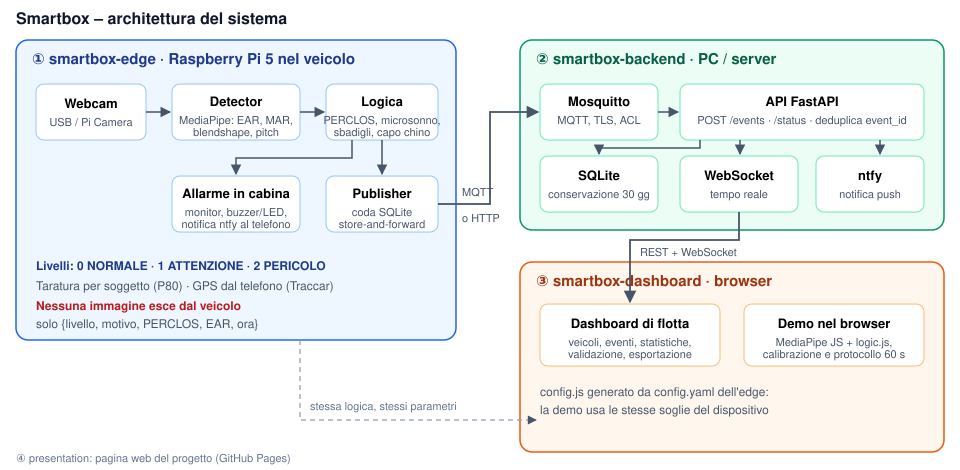

# Smartbox – dispositivo di bordo (Raspberry Pi 5)

Monitoraggio della sonnolenza del guidatore – corso di perfezionamento 2025/26, UniSalento IDA Lab.

## Il progetto

**Smartbox** è un sistema per il monitoraggio della sonnolenza del guidatore. Una webcam nell'abitacolo,
collegata a un Raspberry Pi 5, osserva il volto del guidatore; il software di bordo misura chiusura degli
occhi (PERCLOS e microsonni), sbadigli e chinamento del capo e classifica lo stato su tre livelli:
**0 NORMALE**, **1 ATTENZIONE**, **2 PERICOLO**. L'allarme scatta in cabina (monitor, buzzer/LED,
notifica sul telefono) anche senza rete. Al server di flotta arriva solo una sintesi di ogni evento:
**nessuna immagine esce dal veicolo**.

Il progetto nasce da un prototipo di tesi (notebook Colab, versione 3) ed è stato portato a un sistema
completo *dispositivo di bordo → backend → dashboard web* (versione 4.1), verificato con prove registrate
e con l'installazione su Raspberry Pi 5.

Pagina di presentazione: **https://unisalento-idalab-corsoperfez-25-26.github.io/perfez-2526-presentation-Congedo/**

## Architettura del sistema



1. **Dispositivo di bordo (edge)**: acquisizione, misure dal volto con MediaPipe Face Landmarker,
   logica di allarme, allarme in cabina e invio degli eventi con coda *store-and-forward*.
2. **Backend**: riceve eventi e stati via MQTT (Mosquitto, TLS, ACL) o HTTP, li deduplica, li archivia in
   SQLite, li spinge alla dashboard via WebSocket e invia notifiche ntfy.
3. **Dashboard**: dashboard di flotta e demo nel browser, che esegue la stessa logica del dispositivo.
4. **Presentazione**: pagina web del progetto.

Formato degli eventi (`smartbox-evento/2`): `event_id`, veicolo, ora ISO 8601 con fuso, livello e livello
precedente, motivo, PERCLOS, EAR. Gli stati periodici (`smartbox-stato/1`) riportano fps, temperatura e
modalità del dispositivo.

## Repository dei componenti

| Componente | Repository |
|---|---|
| Dispositivo di bordo (Raspberry Pi 5) | [perfez-2526-smartbox-edge-Congedo](https://github.com/UniSalento-IDALab-corsoPerfez-25-26/perfez-2526-smartbox-edge-Congedo) |
| Backend (API, MQTT, archivio, notifiche) | [perfez-2526-smartbox-backend-Congedo](https://github.com/UniSalento-IDALab-corsoPerfez-25-26/perfez-2526-smartbox-backend-Congedo) |
| Dashboard di flotta e demo nel browser | [perfez-2526-smartbox-dashboard-Congedo](https://github.com/UniSalento-IDALab-corsoPerfez-25-26/perfez-2526-smartbox-dashboard-Congedo) |
| Pagina di presentazione (GitHub Pages) | [perfez-2526-presentation-Congedo](https://github.com/UniSalento-IDALab-corsoPerfez-25-26/perfez-2526-presentation-Congedo) |

## Questo repository: dispositivo di bordo (edge)

Software che gira sul Raspberry Pi 5 nel veicolo (e, per sviluppo, su un PC con webcam). È eseguibile da
solo: per il Raspberry serve solo questo repository.

### Struttura

| Percorso | Contenuto |
|---|---|
| `smartbox/` | Un modulo per funzione: `sources.py` (camera USB, Pi Camera, file video), `detector.py` (EAR, MAR, blendshape, pitch con MediaPipe), `logic.py` (regole e livelli), `score.py` (score 0–1), `calibration.py` (taratura per soggetto), `alerts.py` (buzzer/LED con self-test), `display.py` (allarme a schermo), `preview.py` (anteprima web locale), `publisher.py` (coda verso il server), `gps.py` (posizione dal telefono), `phone.py` (ntfy), `config.py`; `main.py` è il ciclo che li collega |
| `config.yaml` | Tutti i parametri e le soglie: nessun numero da tarare nel codice |
| `secrets.example.yaml` | Modello dei segreti del veicolo (il vero `secrets.yaml` non va mai nel repository) |
| `tests/` | Test di regressione della logica (`pytest`) |
| `tools/` | `replay.py` (logica sui dati registrati), `evaluate.py` (precisione, richiamo, latenza, sensibilità della soglia), `calibra.py` (taratura da una prova), `modello.py` (score 0–1), `genera_config_js.py` (parametri per la demo nel browser) |
| `deploy/raspberry/` | Installazione su Raspberry Pi 5: `setup_pi.sh`, servizio con allarme a schermo, ntfy, guida completa in [LEGGIMI.md](deploy/raspberry/LEGGIMI.md) |
| `deploy/smartbox.service` | Servizio systemd senza monitor (buzzer/LED) |
| `setup.ps1`, `verifica.ps1` | Preparazione e verifica su Windows |

### Funzionamento

- Ciclo a 4 thread: acquisizione (coda di 1 fotogramma), elaborazione, attuazione, comunicazione; il ciclo
  di visione non aspetta mai la rete.
- Occhio chiuso dalle blendshape di MediaPipe (palpebra chiusa e scarto palpebra − occhi stretti), con
  l'EAR come ripiego; soglie tarate sul guidatore con il criterio P80.
- PERCLOS su 60 s, microsonno ≥ 1,5 s, sbadigli ripetuti, capo chino; isteresi e discesa graduale 2 → 1 → 0.
- Volto assente o camera scollegata: livello 1 e riapertura automatica della camera.
- Eventi in coda SQLite con ritentativi e conferma (PUBACK o 2xx), `event_id` per la deduplicazione.

### Installazione sul Raspberry Pi 5

```bash
sudo apt update && sudo apt install -y git libgl1 libglib2.0-0
curl -LsSf https://astral.sh/uv/install.sh | sh
git clone https://github.com/UniSalento-IDALab-corsoPerfez-25-26/perfez-2526-smartbox-edge-Congedo.git ~/perfez-2526-smartbox-edge-Congedo
cd ~/perfez-2526-smartbox-edge-Congedo && bash deploy/raspberry/setup_pi.sh
sudo cp deploy/raspberry/smartbox-schermo.service /etc/systemd/system/
sudo systemctl daemon-reload && sudo systemctl enable --now smartbox-schermo
```
Taratura, invio degli eventi al backend, GPS, notifiche sul telefono e problemi noti:
[deploy/raspberry/LEGGIMI.md](deploy/raspberry/LEGGIMI.md).

### Su un PC (sviluppo)

Serve **Python 3.12** (mediapipe 0.10.14 non supporta la 3.13).
```bash
python -m venv .venv
.venv\Scripts\activate            # Linux/macOS: source .venv/bin/activate
pip install -r requirements.txt
python -m pytest -q
python -m smartbox.main --show     # webcam con gli indicatori a video
```
Su Windows: `powershell -ExecutionPolicy Bypass -File .\setup.ps1`.

Per inviare gli eventi al backend: `forward.http.enabled: true` in `config.yaml` (o in `locale.yaml` sul
Raspberry) e in `secrets.yaml` lo stesso token del veicolo registrato nel `devices.yaml` del
[backend](https://github.com/UniSalento-IDALab-corsoPerfez-25-26/perfez-2526-smartbox-backend-Congedo).

### Dati delle prove

I dati delle prove registrate non sono nel repository. Per il replay vanno messi in
`data/prova1 … data/provaN` (`indicatori.csv`, `annotazioni.csv`, `eventi.csv`, `config_tarata.yaml`), poi:
```bash
python tools/replay.py --tutte
python tools/evaluate.py data/prova4/eventi.csv data/prova4/annotazioni.csv --tolleranza 3
```

### Collegamento con la dashboard

La demo nel browser usa gli stessi parametri del dispositivo: `config.js` del
[repository dashboard](https://github.com/UniSalento-IDALab-corsoPerfez-25-26/perfez-2526-smartbox-dashboard-Congedo) si genera da `config.yaml` con
`python tools/genera_config_js.py`, con i due repository clonati nella stessa cartella. Il test
`test_config_js_allineato` controlla che siano allineati (viene saltato se la dashboard non è presente).

### Limiti noti

GPIO, Pi Camera, ACC, consumi e temperature non sono ancora misurati su hardware; la validazione è su un
soggetto; la regola blendshape va ripetuta al sole e con occhiali.

## Licenza

GPL-3.0, vedi [LICENSE](LICENSE).
